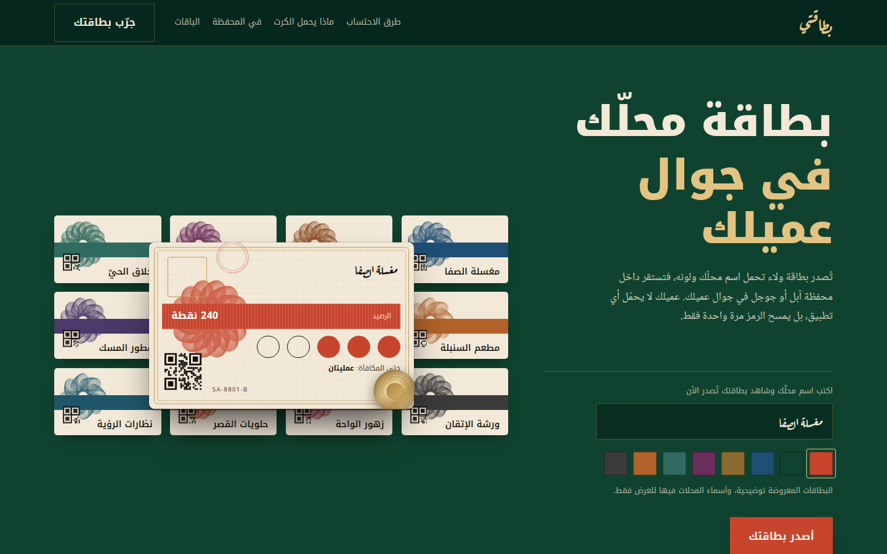
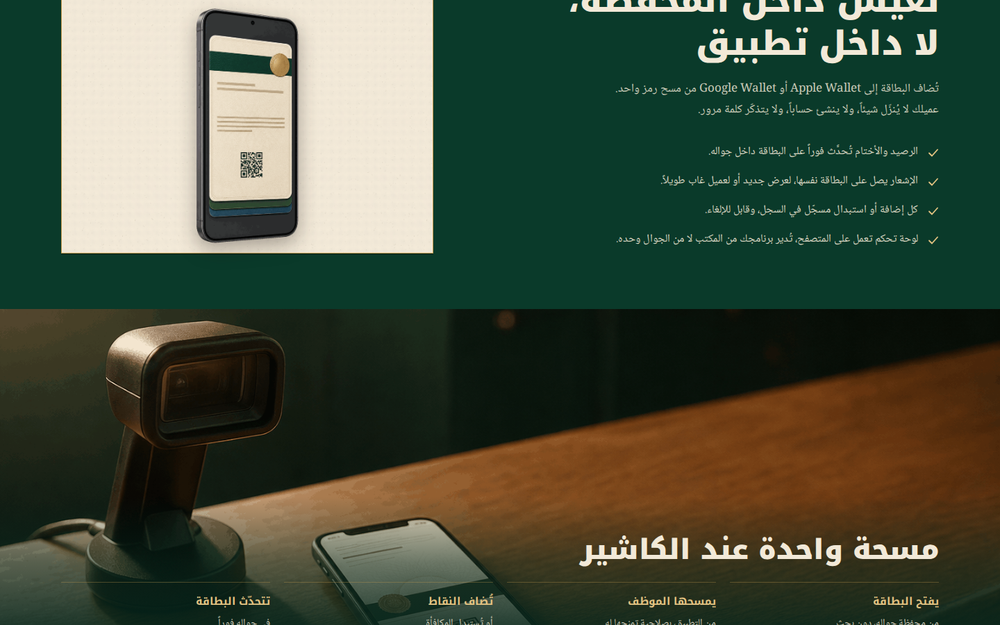
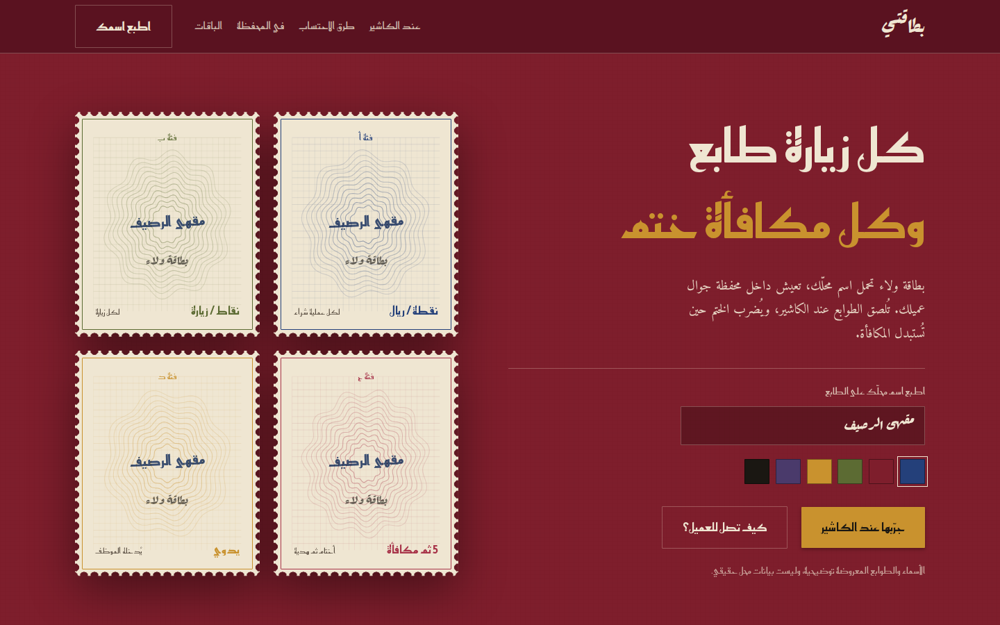
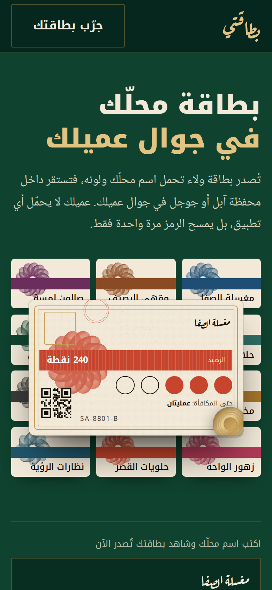

# Bitaqati: landing page for a digital loyalty card

بطاقتي: صفحة هبوط لمنصة بطاقات ولاء رقمية تعيش في محفظة جوال العميل.

An Arabic, right-to-left landing page for a loyalty-card platform: a shop owner types the shop's name, picks its colour, and sees their own stamp card appear live, ready to sit in a customer's Apple Wallet or Google Wallet with no app to download.

**Live:** https://omar2395.github.io/bitaqati/



## What's on the page

- **Live card builder in the hero.** Type a shop name and choose a colour, and the card reissues itself with a short print animation.
- **How the card works:** stamps, points per riyal, points per visit, and "buy 5, get the sixth", each with its own small illustration.
- **Wallet section** showing the pass on a phone, and the one-scan flow at the cashier.
- **Plans and limits** laid out as printed specification sheets.
- **A second visual direction,** [`stamps.html`](https://omar2395.github.io/bitaqati/stamps.html), built around postage-stamp cards and an ink overprint.
- Arabic typography (Aref Ruqaa, Noto Kufi, Noto Naskh), responsive down to phone width, and `prefers-reduced-motion` respected.






## Run it

Plain HTML and CSS with no build step. Open `index.html` in a browser, or serve the folder:

```bash
npx serve .
```

The shop names and card numbers on the page are illustrative.
